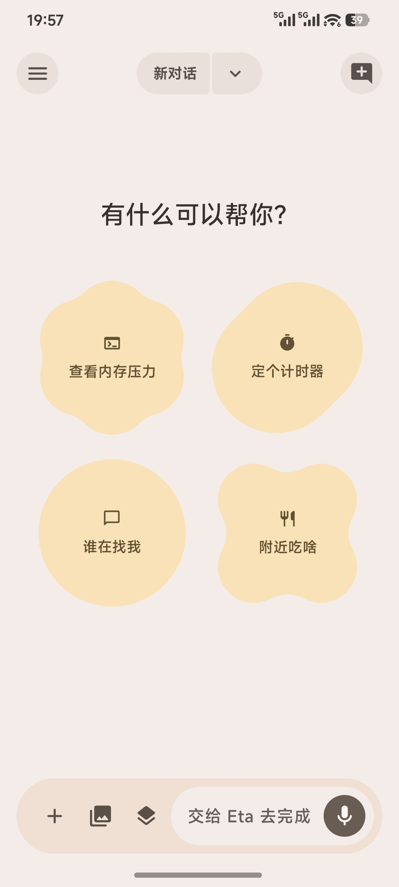
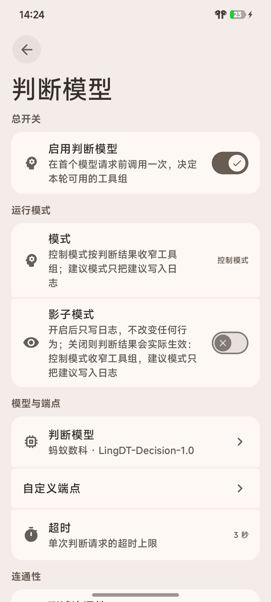
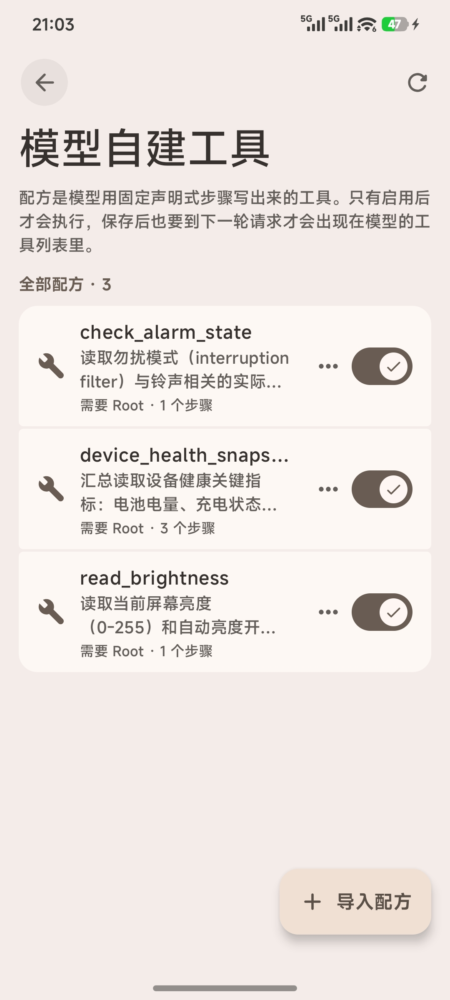
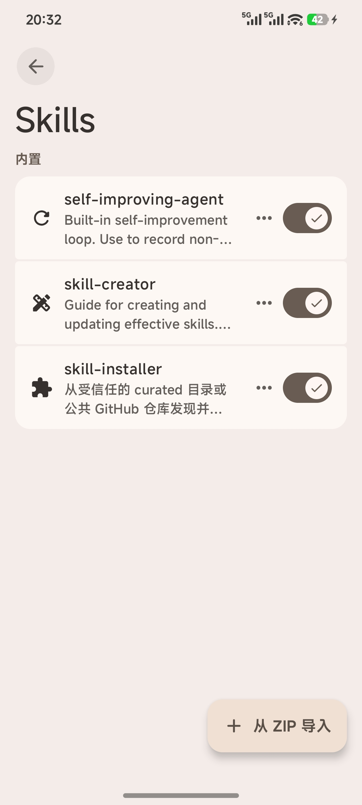

# EtaExpressive
**简体中文** | [English](README_EN.md)

    

**越过沙盒的 Android 系统级 AI 助手**

EtaExpressive 不仅是一个聊天框。将您自己的模型接入手机：它可以调用系统 API、查看屏幕、运行终端、读写文件，也能检索通知、日程、相册等本机信息。在同一轮对话中，提问与任务执行可无缝衔接。

本项目基于 [Eta](https://github.com/Mangi-11/Eta)。上游项目已构建了 Agent Runtime、系统入口和工具层；本 Fork 致力于进一步优化日常使用体验，包括压缩策略、备份与还原、打开方式、视觉模型、浏览器以及 Linux 环境。模型与服务商由您自行选择，**需要自备 API Key（BYOK）**。

**它能实际访问的系统范围**：
- **系统**：闹钟、音量、媒体播放与设备状态，直接通过 Android API 调用，无需逐步操作界面。
- **屏幕**：基于无障碍服务的 GUI Agent，支持点击、滚动和文本输入；您可随时停止或接管控制权。
- **终端**：支持 Android Shell 以及 Alpine / Debian Linux，可运行文件、脚本及守护进程任务。
- **本机数据**：通知、相册、日历、短信等；部分数据源需要 Root 权限，以及对应 ROM 与应用的支持。
- **系统入口**：在配备 LSPosed 的环境下，可接管电源键、小布助手和超级小爱，将原生助手入口的任务路由至 EtaExpressive。

支持 **Android 14 及以上的 ARM64（arm64-v8a）设备**。APK 仅打包 ARM64 原生库，不提供 32 位 ARM 与 x86 构建。App 本体不限手机品牌，基础功能无需 Root。Root 和 LSPosed 可进一步解锁系统级访问与助手入口，具体取决于设备授权和 ROM 支持情况。

[下载 APK](https://github.com/Sam-Fic/EtaExpressive/releases/latest) · [快速开始](#快速开始)

## 本 Fork 的变化
本项目在 [Eta 上游](https://github.com/Mangi-11/Eta) 的基础上，主要围绕 **Material Design 3 Expressive（M3E）** 的视觉风格重新设计了界面外观，并补充了一批功能改进。以下列出与上游相比的核心差异（完整改动见提交历史）：

### 外观与 UI
- **Material Design 3 Expressive（M3E）适配**：对话气泡、卡片、按钮与过渡动效均参考 [Material Design 3 Expressive](https://m3.material.io) 的示例规范重新设计，整体视觉更贴近 Google 最新的 Material 表达风格。
- **细节打磨**：界面细节仍在持续优化中，欢迎体验。如有建议，请随时提交 Issue 或 Pull Request。

### 功能改进
- **MCP 自主配置**：新增 `eta_configure_mcp` 工具，允许 Agent 通过对话自行配置 MCP 服务器（增、删、改、查、刷新发现、启用/停用工具），配置将于下一轮对话生效。
- **本地 Skill 安装**：新增 `skills_install_local` 工具，支持直接从手机本地目录（如下载文件夹、解压后的 ZIP、Linux 工作区路径）安装 Skill；自动校验目录内是否仅含单一 Skill，并支持覆盖已有版本。
- **CI 与测试稳定性**：修复了多组单元测试中的时序敏感断言与 Lint 错误，确保 `verify` 作业在 GitHub Actions 中稳定通过。
- **Release 工作流**：跟进实际发版流程，补充了中英双语更新日志的自动生成与 Release Assets 上传功能。

如需完整的新增功能列表，请参阅本仓库的 [Releases](https://github.com/Sam-Fic/EtaExpressive/releases) 与 [提交历史](https://github.com/Sam-Fic/EtaExpressive/commits/main)。

## 界面预览
| GUI Agent | 作为系统语音助手使用 |
| :-------: | :-----------: |
|  |  |

更多界面：聊天、设备工具与设置
| 聊天首页 | 调用子代理 | 系统 API 调用 |
| :---: | :---: | :---: |
|  |  |  |
| 使用 Decision 模型 | 自建工具能力 | Skills |
| :---: | :---: | :---: |
|  |  |  |

## 核心能力
### 执行工具
- **系统 API 调用**：通过 Android API 与系统 Intent 设置闹钟、控制媒体、调整音量、读取设备状态，无需逐步操作界面。
- **GUI Agent**：结合无障碍 UI 树、控件定位与按需截图，执行点击、滚动和输入；通过浮层展示执行状态，支持随时停止和接管。
- **内置浏览器**：通过 WebView 加载页面、提取正文、操作 DOM 与截图；支持桌面/手机模式。您也可以打开同一浏览器会话手动接管。
- **终端与文件**：支持 Android user/root Shell、Alpine / Debian Linux、文件读写与脚本执行，支持会话保持、异步命令和守护任务。

同一项任务可组合多种工具：例如先读取网页资料，再用脚本整理文件；或从通知中找到订单线索，再打开应用确认状态。

### 上下文与扩展
- **个人上下文**：按需检索通知、应用使用情况与位置信息；相册、日历、短信、录音、健康摘要、聊天图片等专用检索需要 Root 权限，部分来源还要求对应 ROM 与应用支持。
- **长期记忆**：使用本机 `MEMORY.md` 保存跨对话背景，核心内容按预算加入上下文，其余按需读取；支持编辑、清空和关闭。
- **Skills**：按需加载任务方法、参考资料与脚本资源，支持从公开 GitHub 仓库安装和本地 ZIP 导入；安装过程不会执行脚本或开启额外权限。
- **MCP**：通过 Streamable HTTP 连接远程工具，支持 Bearer Token；工具逐项启用，与本机工具共同参与任务。

### Agent Runtime
Agent Runtime 运行在 EtaExpressive App 内，来自聊天页面和系统助手的请求共用同一个 Agent Loop。模型通过 Tool Calling 选择工具，执行结果返回至上下文后，再决定下一步操作。工具调用按 JSON Schema 校验，并在执行前检查权限；Hook 进程仅负责入口拦截与结果回传。

Runtime 同时管理流式事件、Steering（引导）、取消和增量 Transcript（转录）。追加指令在当前 Turn 完成后进入下一轮，会话与结果在本机归档；中断后尝试恢复已有记录，不自动重放操作。详细设计见 [Agent Runtime](docs/AGENT_RUNTIME.md)。

## 为移动设备重新设计的终端
EtaExpressive 的终端可由 Agent 调用，也可由您直接操作。多个会话各自保留工作目录与环境；简洁模式按命令展示输入输出，PTY 控制台支持 TUI、快捷键与 ANSI 渲染。异步命令和守护任务均可查看日志并主动停止。

- **Linux 环境**：可选 Alpine 或 Debian。普通设备使用 PRoot，Root 设备还可选择 chroot。两种后端独立安装，不自动迁移数据；PRoot 中的模拟 root 不提供 Android 系统权限。
- **开发工具**：Python、Node.js、SSH、APK 分析与 Kimi Code 可按需安装。
- **文件管理**：私有工作区支持导入、导出；已授权的 Android 目录可共享至 Linux 的 `/workspace/mounts/`，也可在 App 内直接浏览 Linux 文件。

EtaExpressive 本体可读取项目、修改代码、运行命令并验证结果。若想在手机上持续进行编程工作，[Kimi Code](https://github.com/MoonshotAI/kimi-code) 的 **Kimi Web** 提供了更适合移动端的 Web UI，可在浏览器中持续对话、查看代码修改与执行结果，享受完整的 Coding Agent 工作体验，随时随地进行 Vibe Coding。

在 EtaExpressive 中安装 Linux、Node.js 与 Kimi Code 后，即可从首页一键启动 Kimi Web，或在终端运行 `kimi`。Kimi 使用独立的模型配置与会话，需单独完成登录或配置；离开页面后可返回继续使用，也可从 EtaExpressive 主动停止。

## 模型与 BYOK
使用 EtaExpressive 的 AI 功能需要自备模型服务的 **API Key**。可添加 OpenAI-compatible、Anthropic Messages 等自定义服务，也可拉取或手动添加模型。没有内置提供商，密钥和配置均保存在您自己的备份中。

Provider 层支持 OpenAI-compatible Chat Completions、Responses API 和 Anthropic Messages，包括 SSE、Tool Calling、图片输入、视频封面帧与推理内容。您可以自定义服务地址、请求头和请求体，调整上下文长度与思考档位。视觉能力按模型 ID 自动判断，也可在编辑模型时手动覆盖；文本模型默认不发送图片。

提供商配置中的“自定义请求头”默认折叠，可添加、编辑和删除名称/值对，保存后用于模型列表与对话请求；“测试连接”会使用尚未保存的配置。支持覆盖 `User-Agent`，认证和传输请求头仍由 EtaExpressive 管理。连接 OpenCode 官方端点时，EtaExpressive 会自动为每段对话发送稳定的 `x-opencode-session`，无需手动填写；默认客户端标识仍为 `Eta`。

## 系统助手入口
- **长按电源键**：选择唤起系统默认助手、Gemini 或 EtaExpressive。
- **EtaExpressive 系统助手**：从电源键入口打开 EtaExpressive 文字对话面板，支持屏幕上下文与连续追问。
- **小布 / 超级小爱接管**：保留厂商助手的电源键入口，并将请求路由至 EtaExpressive，使用您自行配置的模型。

电源键接管需要 LSPosed 与对应系统的支持。

## 解锁 Gemini 与一圈即搜
- **Gemini 解锁**：补全 Gemini 系统助手能力，支持将 Google App 设为系统应用、锁屏与亮屏状态下的语音输入，以及息屏状态下的热词唤醒补偿。
- **一圈即搜**：解锁一圈即搜功能，可通过长按手势条或双指识屏触发。

需要 LSPosed 与对应系统支持，具体功能与适配说明见 [技术实现](docs/TECHNICAL.md)。

## 权限与数据边界
系统工具、敏感读取、敏感操作、终端与文件、网页浏览、记忆均有独立开关，当前默认开启。Runtime 在执行前会重新检查权限，撤权或断连不会覆盖已保存的配置。

- **数据去向**：任务所需的对话、图片和工具结果会发送给配置的模型服务；本地 Runtime 不代表本地推理。自定义 HTTP 地址会明文传输 API Key 与请求内容。
- **本机记录**：敏感工具及 MCP 的原始参数、结果不写入持久化会话，模型回复仍会保存。通知历史在授权后保存最近 7 天、最多 1000 条；MCP 认证令牌加密保存。
- **会话与备份**：支持消息复制、编辑、从某轮删除和回复重新生成。备份为 ZIP 格式，可覆盖对话、助手、技能、MCP、设置、聊天附件，以及可选的完整 Linux 环境；备份包含 API Key。
- **运行边界**：任务可随时停止或接管。后台运行受 Android 与厂商进程管理影响，强停或重启后需手动启动；系统与应用更新也可能需要重新适配 Hook。

## 快速开始
1. 从 [Releases](https://github.com/Sam-Fic/EtaExpressive/releases/latest) 下载 APK，安装后在“模型提供商”中填写 API Key 并选择模型。执行任务需要 Tool Calling，理解图片还需模型支持图片输入。
2. 按任务需要配置工具开关与权限：GUI Agent 需要无障碍服务；通知、应用使用情况需分别授权；位置工具需要“始终允许”。工具页可查看当前设备的可用能力。
3. 开始对话。需要 Linux 时，在“Linux 工具环境”中安装发行版、基础工具及所需开发工具；需要系统入口时，参见 [系统助手入口](#系统助手入口)。
   - **普通设备**：Android 14+ 的 ARM64 机型，可使用聊天、浏览器、记忆、Skills、MCP、普通终端与私有工作区；GUI 和本机信息读取按需授权。Linux 支持对应的 64 位设备。
   - **Root 设备**：进一步开放系统设置修改、应用管理、受保护文件与专用个人数据检索，以及 Root Shell 和 chroot。
   - **LSPosed 与适配 ROM**：开放厂商助手接管、系统快捷入口及 Google 能力增强；部分功能另需 Root。

联系人、短信、日历等专用检索目前仍需要 Root。完整条件与验证范围见 [设备支持说明](docs/ROOTLESS_SUPPORT.md)。

## 深入了解
- [设备支持与权限边界](docs/ROOTLESS_SUPPORT.md)：普通设备、Root、文件工作区与后台运行。
- [技术实现](docs/TECHNICAL.md)：设备工具、数据检索、浏览器、终端与系统集成。
- [Agent Runtime](docs/AGENT_RUNTIME.md)：Agent Loop、Provider、Steering、Transcript 与结果恢复。
- [HyperOS 系统入口](docs/HYPEROS_SYSTEM_ENTRY.md)：电源键、一圈即搜的适配条件与验证边界。
- [终端原生组件](docs/TERMINAL_NATIVE.md)：PTY、PRoot 及随包源码的构建方式。

## 参考与致谢
- [Eta](https://github.com/Mangi-11/Eta)：本项目基于的上游项目。
- [y2485871697/Eta](https://github.com/y2485871697/Eta)：参考仓库，大量实用功能均来自此分支。
- [Number444/Eta](https://github.com/Number444/Eta)：参考分支，小米超级岛的实现来源：焦点通知 param_v2 官方协议、双通道岛展开机制（新 ID 首发才展开、8 秒自动撤销）与真机全链路测试文档。
- [liyunkkk/Eta](https://github.com/liyunkkk/Eta)：参考分支，灵动岛思维流的实现来源：思考/输出流式预览、工具语义化与通知卡片呼吸动效计时。
- [NatumRagnag/Eta](https://github.com/NatumRagnag/Eta)：参考分支，小米宿主桥接的实现来源：HyperOS 4 UIAgent 工具桥、内部 ToolsBridge 与 Vision / 外部 Agent 服务。
- [Pi Coding Agent](https://github.com/earendil-works/pi)：Agent Runtime 的核心参考，包括 Agent Loop、Tool Calling、Steering 与 Transcript 状态管理。
- [dsh-superagent](https://github.com/deepseek-ai/dsh-superagent-prototype)：DeepSeek 开源的主动式 Agent 研究原型。「调度智能体」的理念来源：主 Session 仅负责路由与研判、工单/授权/准入流水线，以及结构化提问、如实汇报等行为律。
- [TaiJi（太极）](https://github.com/zhushanwen321/tai-ji)：AI Agent 桌面工作台。「调度台」的会话形态与机制参考：受限工具白名单的调度模式、自包含 Brief、Notify-once 完成通知债权与防注入规范。
- [OmniBot](https://github.com/omnimind-ai/OmniBot)：Android AI Agent 方向的参考项目。
- [opencode](https://github.com/sst/opencode)：终端 AI Coding Agent。远程 OpenCode 接入的协议参考，第二版协议 wire 格式核证自其 serve 实现（v2.2.5）。
- [sherpa-onnx](https://github.com/k2-fsa/sherpa-onnx) / [sherpa-ncnn](https://github.com/k2-fsa/sherpa-ncnn)：离线语音运行时。两个项目的 Kotlin JNI 绑定原样引入并随包分发（Apache-2.0），支撑本地语音识别、合成与 VAD。
- [OpenMinis](https://github.com/OpenMinis/OpenMinis)：内置浏览器的改编来源。浏览器源码改编自该项目（GPL-3.0），并做包/资源隔离、Linux 访客路径映射、Cookie 卸载与用户接管等适配，详见 `third_party/openminis-browser/NOTICE.md`。
- [lzhhhhc/imagine](https://github.com/lzhhhhc/imagine)：图像生成协议参考。参考图/遮罩编辑、尺寸档位与 JSON 编辑协议的接口行为核证自其 ApiModels、ImageRepository 等实现。
- [st-chatu8（智绘姬）](https://github.com/damoshen123/st-chatu8)：SillyTavern 插件，NovelAI 工作台的设计思路借鉴来源；未复制源码，仅以其公开接口行为为兼容目标。
- [libxposed API](https://github.com/libxposed/api)：现代 Xposed API。
- [miuix](https://github.com/compose-miuix-ui/miuix)：页面切换转场专用库——NavDisplay 导航容器提供栈式转场动画与系统屏幕圆角适配；界面组件本体为 Material Design 3 Expressive，不使用 miuix 组件。
- [multiplatform-markdown-renderer](https://github.com/mikepenz/multiplatform-markdown-renderer)：聊天消息与悬浮内容的 Markdown 渲染库，提供 Compose 多平台渲染与 Material 3 样式适配。
- [Zafiro](https://github.com/niki914/zafiro)：用户对话气泡的样式参考。其气泡设计与 Google Material Design 3 Expressive 的示例气泡高度相似，因此采用并适配到本项目。
- [Material Design 3 Expressive](https://m3.material.io)：Google Material Design 3 Expressive 官方站点，本程序的界面设计语言与视觉风格均参考自其中的示例与规范。
- [KernelSU](https://github.com/tiann/KernelSU)：本应用“外观与主题”子设置页面的设计参考。
- 此外，感谢所有在手机上本地部署运行的开源模型——包括语音合成与识别模型、Embedding 模型等——它们让 EtaExpressive 能够在不依赖云端的情况下完成语音交互、语义检索与本地推理。

## 社区
- 反馈问题：[GitHub Issues](https://github.com/Sam-Fic/EtaExpressive/issues)
- 源码与发版：[Sam-Fic/EtaExpressive](https://github.com/Sam-Fic/EtaExpressive)

## 许可证
本项目与上游 Eta 一样采用 [PolyForm Noncommercial License 1.0.0](LICENSE)。未经 [原作者](https://github.com/Mangi-11) 书面授权，禁止贩卖、收费代装及其他商业使用。