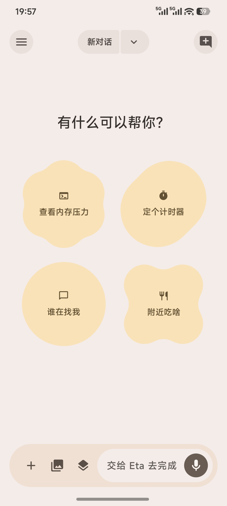
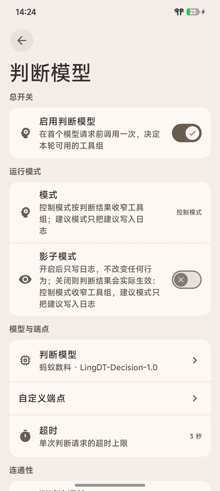
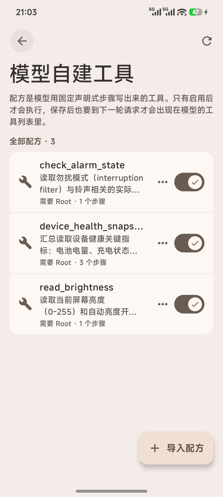
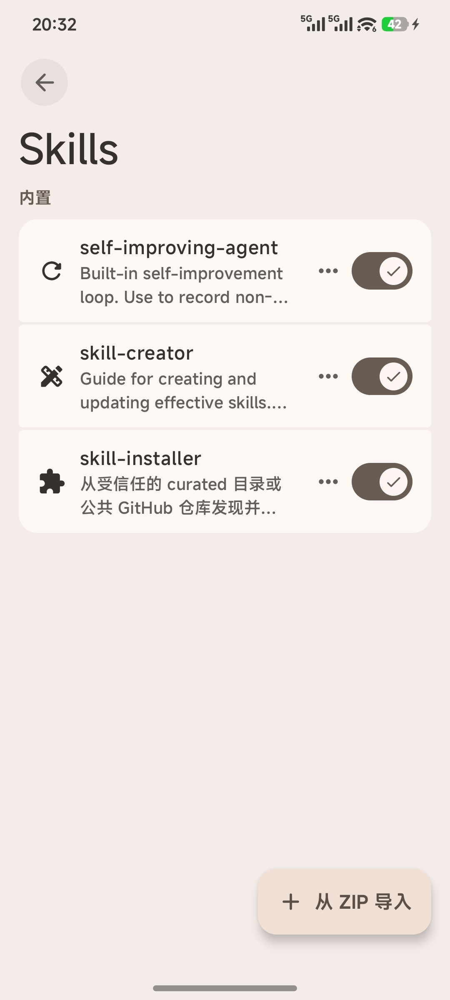

# EtaExpressive
[简体中文](README.md) | **English**

    

**A System-Level Android AI Assistant That Steps Beyond the Sandbox**

EtaExpressive is more than just a chat box. Connect your own model to your phone: it can call system APIs, see the screen, run a terminal, read and write files, and retrieve on-device information such as notifications, calendars, and photos. Asking questions and getting things done can happen seamlessly within the same conversation.

It is based on [Eta](https://github.com/Mangi-11/Eta). The upstream project has built the Agent Runtime, system entry points, and tool layer; this project continues to improve daily usability: compression strategies, backup and restore, open-with actions, vision models, the browser, and the Linux environment. You choose the model and provider, and **you must supply your own API Key (BYOK)**.

**What it can actually reach:**
- **System:** Alarms, volume, media, and device status directly via Android APIs, without navigating through UI menus step by step.
- **Screen:** An accessibility-based GUI Agent for tapping, scrolling, and typing; you can stop or take over at any time.
- **Terminal:** Android Shell and Alpine / Debian Linux, capable of running files, scripts, and daemon tasks.
- **On-device data:** Notifications, photos, calendars, SMS, etc.; some sources require Root, as well as a matching ROM and app.
- **System entry points:** With LSPosed, it can take over the power button, Breeno, and Super XiaoAI, routing tasks from the original assistant entry points to EtaExpressive.

Requires **Android 14 or later on ARM64 (arm64-v8a) devices**. The APK only packages ARM64 native libraries and does not provide 32-bit ARM or x86 builds. The app itself is not brand-locked, and core features do not require Root. Root and LSPosed can further unlock system access and assistant entry points, depending on authorization and ROM support.

[Download APK](https://github.com/Sam-Fic/EtaExpressive/releases/latest) · [Getting Started](#getting-started)

## Changes in This Fork
Built on top of the [Eta upstream](https://github.com/Mangi-11/Eta), this fork primarily redesigns the interface appearance around the **Material Design 3 Expressive (M3E)** visual style and adds a batch of functional improvements. The following lists the core differences compared to the upstream (see commit history for full details):

### Appearance and UI
- **Material Design 3 Expressive (M3E) Adaptation**: Chat bubbles, cards, buttons, and transition animations have been redesigned referencing the example specifications of [Material Design 3 Expressive](https://m3.material.io), making the overall visual style closer to Google's latest Material expressive design.
- **Detail Polish**: Details are continuously being refined. You are welcome to try it out. If you have any suggestions, please feel free to submit an issue or pull request.

### Functional Improvements
- **MCP Self-Configuration**: Added the `eta_configure_mcp` tool, allowing the Agent to configure MCP servers (add, remove, update, query, refresh discovery, enable/disable tools) directly through conversation; configurations take effect from the next turn of conversation.
- **Local Skill Installation**: Added the `skills_install_local` tool, supporting direct installation of Skills from local phone directories (e.g., download folders, extracted ZIPs, Linux workspace paths); it automatically validates whether the directory contains only a single Skill and supports overwriting existing versions.
- **CI and Test Stability**: Fixed timing-sensitive assertions and lint errors in multiple unit tests, ensuring the `verify` job passes stably in GitHub Actions.
- **Release Workflow**: Aligned with the actual release process, adding automatic generation of bilingual (Chinese/English) changelogs and Release Assets uploads.

For a complete list of new features, please refer to this repository's [Releases](https://github.com/Sam-Fic/EtaExpressive/releases) and [commit history](https://github.com/Sam-Fic/EtaExpressive/commits/main).

## Interface Preview
| GUI Agent | Using as a System Voice Assistant |
| :-------: | :-----------: |
|  |  |

More interfaces: Chat, Device Tools, and Settings
| Chat Home | Calling Subagents | System API Calls |
| :-----------------------------------------: | :------------------------------------------------------------: | :-------------------------------------------------------: |
|  |  |  |
| Using Decision Model | Custom Tool Capabilities | Skills |
| :------------------------------------: | :-------------------------------------: | :------------------------------------: |
|  |  |  |

## Core Capabilities
### Execution Tools
- **System API Calls**: Set alarms, control media, adjust volume, and read device status via Android APIs and system intents, without step-by-step UI navigation.
- **GUI Agent**: Combines accessibility UI trees, control targeting, and on-demand screenshots to execute taps, scrolls, and inputs; displays execution status via an overlay, supporting stopping and takeover.
- **Built-in Browser**: Loads pages via WebView, extracts main text, manipulates the DOM, and captures screenshots; supports desktop/mobile modes. You can also open the same browser session to take control.
- **Terminal and Files**: Android user/root Shell, Alpine / Debian Linux, file reading/writing, and script execution, supporting sessions, asynchronous commands, and daemon tasks.

A single task can combine multiple tools: for example, reading web materials first, then organizing files with a script; or finding order clues in notifications, then opening the app to confirm the status.

### Context and Extensions
- **Personal Context**: Retrieve notifications, app usage, and location on demand. Dedicated retrieval for photos, calendars, SMS, recordings, health summaries, and chat images requires Root, and some sources also require corresponding ROM and app support.
- **Long-term Memory**: Uses the local `MEMORY.md` to save cross-conversation context. Core content is added to the context within budget, and the rest is read on demand; supports editing, clearing, and disabling.
- **Skills**: Load task methods, reference materials, and script resources on demand. Supports installation from public GitHub repositories and local ZIP import; installation does not execute scripts or grant additional permissions.
- **MCP**: Connects to remote tools via Streamable HTTP, supporting Bearer Token; tools are enabled individually and participate in tasks alongside local tools.

### Agent Runtime
The Agent Runtime runs inside the EtaExpressive App. Requests from the chat page and system assistants share the same Agent Loop. The model selects tools via Tool Calling, execution results return to the context, and it decides the next step. Tool calls are validated against JSON Schema, and permissions are checked before execution. The Hook process is only responsible for the entry point and result return.

The Runtime also manages streaming events, steering, cancellation, and incremental transcripts. Appended instructions enter the next turn after the current turn completes. Sessions and results are archived locally; after an interruption, it attempts to recover existing records without automatically replaying actions. For detailed design, see [Agent Runtime](docs/AGENT_RUNTIME.md).

## A Terminal Redesigned for Mobile Devices
The terminal in EtaExpressive can be invoked by the Agent or operated directly by you. Multiple sessions retain their respective working directories and environments; compact mode displays input and output by command, while the PTY console supports TUI, shortcuts, and ANSI rendering. Asynchronous commands and daemon tasks can have their logs viewed and be actively stopped.

- **Linux Environment**: Optional Alpine or Debian. Ordinary devices use PRoot, while Rooted devices can also choose chroot. The two backends are installed independently and do not automatically migrate data; simulated root in PRoot does not provide Android system privileges.
- **Development Tools**: Python, Node.js, SSH, APK analysis, and Kimi Code can be installed on demand.
- **File Management**: Private workspaces support import and export; authorized Android directories can be shared to `/workspace/mounts/` in Linux, and Linux files can also be browsed within the App.

EtaExpressive itself can read projects, modify code, run commands, and verify results. If you want to continue programming work on your phone, [Kimi Code](https://github.com/MoonshotAI/kimi-code)'s **Kimi Web** provides a Web UI better suited for mobile devices, allowing you to continue conversations, view code modifications, and check execution results in the browser, enjoying a complete Coding Agent workflow for Vibe Coding anytime, anywhere.

After installing Linux, Node.js, and Kimi Code in EtaExpressive, you can launch Kimi Web with one click from the home page, or run `kimi` in the terminal. Kimi uses independent model configurations and sessions, requiring separate login or configuration; you can return to continue using it after leaving the page, or actively stop it from EtaExpressive.

## Models and BYOK
Using EtaExpressive's AI features requires your own model service **API Key**. You can add OpenAI-compatible, Anthropic Messages, or other custom services, or pull/manual add models. There are no built-in providers; keys and configurations are in your own backup.

The Provider layer supports OpenAI-compatible Chat Completions, Responses API, and Anthropic Messages, including SSE, Tool Calling, image input, video cover frames, and reasoning content. You can customize service addresses, request headers, and request bodies, and adjust context length and reasoning tiers. Vision capabilities are automatically determined by model ID, or can be manually overridden when editing the model; text models do not send images by default.

"Custom Request Headers" in the provider configuration are collapsed by default, allowing you to add, edit, and delete name/value pairs, which are saved and used for model lists and conversation requests; "Test Connection" will use the unsaved configuration. Supports overriding `User-Agent`, while authentication and transport request headers are still managed by EtaExpressive. When connecting to the official OpenCode endpoint, EtaExpressive automatically sends a stable `x-opencode-session` for each conversation segment, eliminating the need for manual entry; the default client identifier remains `Eta`.

## System Assistant Entry Points
- **Long-press Power Button**: Choose to wake up the system default assistant, Gemini, or EtaExpressive.
- **EtaExpressive System Assistant**: Open the EtaExpressive text conversation panel from the power button entry, supporting screen context and continuous follow-up questions.
- **Breeno / Super XiaoAI Takeover**: Retain the OEM assistant's power button entry point, but route requests to EtaExpressive using your own configured model.

Power button takeover requires LSPosed and corresponding system support.

## Unlocking Gemini and Circle to Search
- **Gemini Unlock**: Completes Gemini system assistant capabilities, supporting systematic Google App integration, lock screen and screen-on voice input, and screen-off hotword compensation.
- **Circle to Search**: Unlocks Circle to Search, triggered by long-pressing the gesture bar or two-finger screen recognition.

Requires LSPosed and corresponding system support. For specific functionality and adaptation instructions, see [Technical Implementation](docs/TECHNICAL.md).

## Permissions and Data Boundaries
System tools, sensitive reads, sensitive operations, terminal and files, web browsing, and memory have independent switches, currently enabled by default. The Runtime rechecks permissions before execution; revoking permissions or disconnecting will not overwrite saved configurations.

- **Data Destination**: Conversation, images, and tool results required for tasks will be sent to the configured model service; a local Runtime does not imply local inference. Custom HTTP addresses will transmit API Keys and request content in plaintext.
- **Local Records**: Raw parameters and results of sensitive tools and MCP are not written to persistent sessions, though model replies are still saved. Notification history saves the last 7 days, up to 1,000 entries, after authorization; MCP authentication tokens are saved encrypted.
- **Sessions and Backups**: Supports message copying, editing, deleting from a specific turn, and reply regeneration. Backups are in ZIP format, which can overwrite conversations, assistants, skills, MCP, settings, chat attachments, and optionally the complete Linux environment; backups include API Keys.
- **Execution Boundaries**: Tasks can be stopped or taken over. Background execution is subject to Android and OEM process management; manual startup is required after a force stop or reboot; system and app updates may also require Hook re-adaptation.

## Getting Started
1. Download the APK from [Releases](https://github.com/Sam-Fic/EtaExpressive/releases/latest). After installation, fill in your API Key and select a model in "Model Provider". Task execution requires Tool Calling, and understanding images requires the model to support image input.
2. Configure tool switches and permissions as needed: GUI Agent requires accessibility services; notifications and app usage require separate authorization; location tools require "Allow all the time". The tools page shows the available capabilities of the current device.
3. Start a conversation. When Linux is needed, install the distribution, base tools, and required development tools in "Linux Tool Environment"; for system entry points, refer to [System Assistant Entry Points](#system-assistant-entry-points).
- **Ordinary Devices**: Android 14+ ARM64 devices can use chat, browser, memory, Skills, MCP, ordinary terminal, and private workspaces; GUI and on-device information retrieval require on-demand authorization. Linux supports corresponding 64-bit devices.
- **Rooted Devices**: Further opens system setting modifications, app management, protected files, dedicated personal data retrieval, Root Shell, and chroot.
- **LSPosed and Adapted ROMs**: Opens OEM assistant takeover, system shortcut entries, and Google capability enhancements; some features additionally require Root.

Dedicated retrieval for contacts, SMS, and calendars currently still requires Root. For full conditions and validation scope, see [Device Support Instructions](docs/ROOTLESS_SUPPORT.md).

## Deep Dive
- [Device Support and Permission Boundaries](docs/ROOTLESS_SUPPORT.md): Ordinary devices, Root, file workspaces, and background execution.
- [Technical Implementation](docs/TECHNICAL.md): Device tools, data retrieval, browser, terminal, and system integration.
- [Agent Runtime](docs/AGENT_RUNTIME.md): Agent Loop, Provider, steering, transcript, and result recovery.
- [HyperOS System Entry Points](docs/HYPEROS_SYSTEM_ENTRY.md): Adaptation conditions and validation boundaries for power button and Circle to Search.
- [Native Terminal Components](docs/TERMINAL_NATIVE.md): PTY, PRoot, and build methods for bundled source code.

## References and Acknowledgements
- [Eta](https://github.com/Mangi-11/Eta): The upstream project this project is based on.
- [y2485871697/Eta](https://github.com/y2485871697/Eta): Reference repository; many practical features come from this branch.
- [Number444/Eta](https://github.com/Number444/Eta): Reference branch, source of Xiaomi Super Island implementation: official protocol for focus notification param_v2, dual-channel island expansion mechanism (expands only on first post, auto-dismisses in 8 seconds), and full-link on-device measurement documentation.
- [liyunkkk/Eta](https://github.com/liyunkkk/Eta): Reference branch, source of Dynamic Island thought stream implementation: streaming preview of thinking/output, semantic tool labeling, and notification card breathing chronometer.
- [NatumRagnag/Eta](https://github.com/NatumRagnag/Eta): Reference branch, source of Xiaomi host bridging implementation: HyperOS 4 UIAgent tool bridge, internal ToolsBridge, and vision / external Agent services.
- [Pi Coding Agent](https://github.com/earendil-works/pi): Core reference for Agent Runtime, including Agent Loop, Tool Calling, steering, and transcript state management.
- [dsh-superagent](https://github.com/deepseek-ai/dsh-superagent-prototype): Open-source proactive agent research prototype by DeepSeek. Source of the "Dispatch Agent" concept: main Session only routes and assesses, ticket/authorization/admission pipeline, and behavioral disciplines like structured questioning and truthful reporting.
- [TaiJi](https://github.com/zhushanwen321/tai-ji): AI Agent desktop workspace. Reference for the "Dispatch Console" session form and mechanism: restricted tool whitelist dispatch mode, self-contained briefs, notify-once completion notification claims, and anti-injection discipline.
- [OmniBot](https://github.com/omnimind-ai/OmniBot): Reference project for Android AI Agent direction.
- [opencode](https://github.com/sst/opencode): Terminal AI coding agent. Protocol reference for remote OpenCode integration; the second protocol wire was verified from its serve implementation (v2.2.5).
- [sherpa-onnx](https://github.com/k2-fsa/sherpa-onnx) / [sherpa-ncnn](https://github.com/k2-fsa/sherpa-ncnn): offline speech runtime. The Kotlin JNI bindings of both projects are bundled (Apache-2.0), powering local speech recognition, synthesis, and VAD.
- [OpenMinis](https://github.com/OpenMinis/OpenMinis): adapted source of the built-in browser. The browser code is adapted from this project (GPL-3.0) with package/resource isolation, Linux guest path mapping, cookie offload, and user takeover; see `third_party/openminis-browser/NOTICE.md`.
- [lzhhhhc/imagine](https://github.com/lzhhhhc/imagine): image-generation protocol reference. Reference-image/mask editing, size tiers, and the JSON edit protocol were verified against its ApiModels and ImageRepository implementations.
- [st-chatu8](https://github.com/damoshen123/st-chatu8): a SillyTavern plugin and the design inspiration for the NovelAI workbench; no source was copied, only its public interface behavior as the compatibility target.
- [libxposed API](https://github.com/libxposed/api): Modern Xposed API.
- [miuix](https://github.com/compose-miuix-ui/miuix): Page transition dedicated library — NavDisplay navigation container provides stack transition animations and system screen corner adaptation; the UI components themselves are Material Design 3 Expressive, not using miuix components.
- [multiplatform-markdown-renderer](https://github.com/mikepenz/multiplatform-markdown-renderer): Markdown rendering library for chat messages and overlay content, with Compose multiplatform rendering and Material 3 styling.
- [Zafiro](https://github.com/niki914/zafiro): Style reference for user conversation bubbles. Its bubble design is highly similar to Google Material Design 3 Expressive example bubbles, hence adopted and adapted into this project.
- [Material Design 3 Expressive](https://m3.material.io): Official Google Material Design 3 Expressive site; the program's interface design language and visual style are referenced from its examples and specifications.
- [KernelSU](https://github.com/tiann/KernelSU): Design reference for this app's "Appearance and Theme" sub-settings page.
- Additionally, thanks to all open-source models deployed and run locally on phones—including speech synthesis and recognition models, Embedding models, etc.—they enable EtaExpressive to complete voice interaction, semantic retrieval, and local inference without relying on the cloud.

## Community
- Feedback: [GitHub Issues](https://github.com/Sam-Fic/EtaExpressive/issues)
- Source Code and Releases: [Sam-Fic/EtaExpressive](https://github.com/Sam-Fic/EtaExpressive)

## License
This project, like the upstream Eta, adopts the [PolyForm Noncommercial License 1.0.0](LICENSE). Without written authorization from the [original author](https://github.com/Mangi-11), selling, paid installation, and other commercial uses are prohibited.