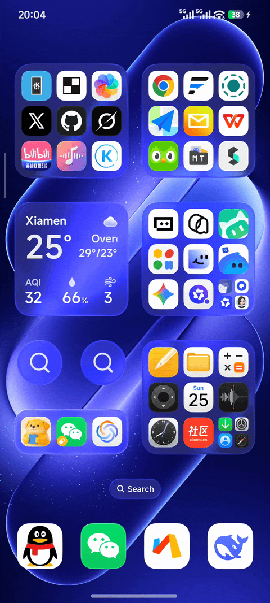
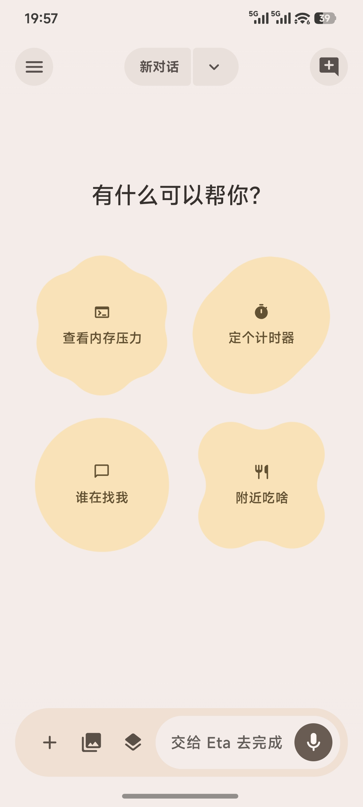
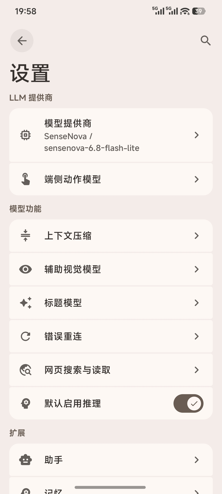
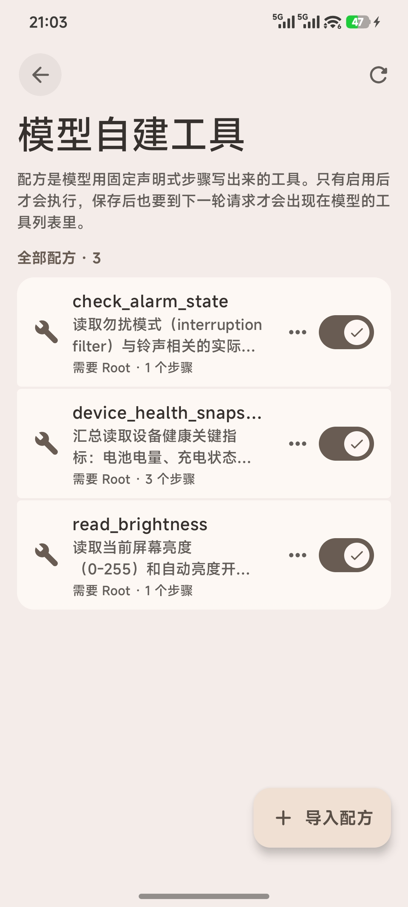
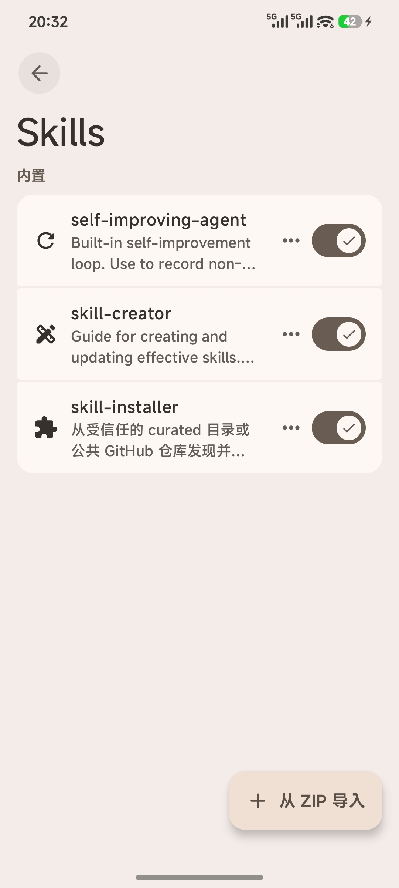

# EtaExpressive

[简体中文](README.md) | **English**

    

**A system-level Android AI assistant that steps past the sandbox**

EtaExpressive is more than a chat box. Point your own model at the phone: it can call system APIs, see the screen, run a terminal, read and write files, and look up notifications, calendars, photos, and other local data. Asking and doing can happen in the same conversation.

It is based on [Eta](https://github.com/Mangi-11/Eta). Upstream built the agent runtime, system entry points, and tool layer. This fork keeps iterating on daily use: compression, backup and restore, share-to-open, vision models, the browser, and the Linux environment. **You supply your own API key (BYOK)** and choose the model.

**What it can actually reach:**

- **System:** alarms, volume, media, and device status through Android APIs, without walking through menus.
- **Screen:** an accessibility GUI agent for taps, scrolls, and typing. You can stop or take over at any time.
- **Terminal:** Android shells plus Alpine / Debian Linux, including files, scripts, and daemon tasks.
- **On-device data:** notifications, photos, calendars, SMS, and more. Some sources need root, plus a matching ROM and app.
- **System entry points:** with LSPosed, route the power button, Breeno, or Super XiaoAI into EtaExpressive.

Requires **Android 14 or later on ARM64 (arm64-v8a)**. The APK ships ARM64 native libraries only; there are no 32-bit ARM or x86 builds. The app is not brand-locked; core features work without root. Root and LSPosed unlock more system access and assistant integration, depending on permission and ROM support.

[Download APK](https://github.com/Sam-Fic/EtaExpressive/releases/latest) · [Getting started](#getting-started)

## See it in action

| GUI Agent | Breeno with your own model |
| :---: | :---: |
|  |  |

More screenshots: chat, system tools, and settings

| Chat | Commands through Breeno | Direct system API calls |
| :---: | :---: | :---: |
|  |  |  |

| Settings | Tools | Skills |
| :---: | :---: | :---: |
|  |  |  |

## Core capabilities

### Execution tools

- **Direct system API calls:** use Android APIs and system intents to set alarms, control media, adjust volume, and read device status without navigating through app screens.
- **GUI Agent:** combine the accessibility UI tree, element targeting, and screenshots taken as needed to tap, scroll, and type. An overlay shows execution status, and you can stop or take over.
- **Built-in browser:** load JavaScript pages in a WebView, extract readable content, interact with the DOM, and capture screenshots. You can open the same browser session to take control.
- **Terminal and files:** use Android `user`/`root` shells, Alpine or Debian Linux, file operations, and scripts, with support for persistent sessions, asynchronous commands, and daemon tasks.

A task can combine these tools: read web sources and then organize files with a script, or find order details in notifications and open the relevant app to check their status.

### Context and extensions

- **Personal context:** retrieve notifications, app usage, and location on demand. Dedicated searches for photos, calendar events, SMS messages, recordings, health summaries, and chat images require root; some sources also depend on the ROM and installed apps.
- **Long-term memory:** store context for future conversations in a local `MEMORY.md`. Core memory is included within a context budget, with the rest retrieved as needed. You can edit, clear, or disable it.
- **Skills:** load task instructions, reference material, and script resources as needed. Install from public GitHub repositories or import a local ZIP. Installation does not run scripts or grant additional permissions.
- **MCP:** connect remote tools over Streamable HTTP, with optional bearer-token authentication. Enable tools individually to use them alongside local tools.

### Agent runtime

The runtime runs inside EtaExpressive. Requests from chat and system assistants use the same agent loop: the model selects tools through tool calling, execution results return to its context, and it decides what to do next. Calls are validated against JSON Schema and permissions are checked before execution. Hooked processes only handle the entry point and return path.

The runtime also manages streaming events, steering, cancellation, and incremental transcripts. Steering messages enter after the current turn completes. Conversations and results are stored locally; after an interruption, EtaExpressive attempts to recover existing records without automatically replaying actions. See [Agent Runtime](docs/AGENT_RUNTIME.md) for implementation details.

## A terminal designed for mobile

You can use EtaExpressive's terminal yourself or let the agent use it. Each session retains its working directory and environment. The compact view groups input and output by command; the PTY console supports TUIs, keyboard shortcuts, and ANSI rendering. Asynchronous commands and daemon tasks have logs and explicit stop controls.

- **Linux environments:** choose Alpine or Debian. PRoot works without root; rooted devices can also use chroot. The backends have separate installations, with no automatic data migration. PRoot's simulated root identity does not grant Android system privileges.
- **Development tools:** install Python, Node.js, SSH, APK analysis tools, and Kimi Code as needed.
- **File management:** import and export files through the private workspace, share accessible Android directories under `/workspace/mounts/` in Linux, and browse Linux files from the app.

EtaExpressive itself can read projects, edit code, run commands, and verify results. For longer coding sessions on a phone, [Kimi Code](https://github.com/MoonshotAI/kimi-code)'s **Kimi Web** offers a web UI well suited to mobile. Continue a conversation, inspect code changes, and review execution results in your browser, with a full coding-agent workflow for vibe coding wherever you are.

After installing Linux, Node.js, and Kimi Code in EtaExpressive, launch Kimi Web from the home screen or run `kimi` in the terminal. Kimi has its own model configuration and sessions, so it requires a separate sign-in or setup. You can return to a running instance after leaving the page, or stop it from EtaExpressive.

## Models and BYOK

EtaExpressive's AI features require **your own model-provider API key**. Add OpenAI-compatible or Anthropic Messages services, fetch model lists, or add models by hand. There are no built-in providers; keys and configuration live in your own backup.

The provider layer supports OpenAI-compatible Chat Completions, the Responses API, and Anthropic Messages, including SSE streaming, tool calling, image input, and reasoning content. Configure custom endpoints, headers, and request bodies; fetch model lists or add models manually; and override context windows and reasoning effort. Available features depend on the model and API. Some Responses providers also support server-side web search.

## System assistant entry points

- **Power-button long press:** choose the default OEM assistant, Gemini, or EtaExpressive.
- **EtaExpressive system assistant:** open EtaExpressive's text conversation panel from the power button, with screen context and follow-up conversations.
- **Breeno / Super XiaoAI integration:** keep the familiar OEM assistant entry point while routing requests to EtaExpressive and your configured model.

Power-button interception requires LSPosed and a supported system.

## Unlocking Gemini and Circle to Search

- **Gemini:** enable system-assistant capabilities, including making the Google app a system app, voice input on the lock screen and while the screen is on, and support for keeping hotword detection working with the screen off.
- **Circle to Search:** enable the feature and trigger it with a long press on the navigation handle or a two-finger long press on the screen.

These features require LSPosed and a supported system. See [Technical Implementation](docs/TECHNICAL.md) for functionality and compatibility details.

## Permissions and data

System tools, sensitive reads, sensitive actions, terminal and file access, browsing, and memory have separate switches, currently enabled by default. The runtime rechecks permissions before execution. Revoked access or a lost connection does not overwrite your saved settings.

- **Model requests:** task-relevant conversation content, images, and tool results are sent to your configured provider. A local runtime does not imply local inference. Custom HTTP endpoints transmit API keys and request content without transport encryption.
- **Local records:** raw arguments and results from sensitive tools and MCP tools are excluded from persistent conversation history; model replies are still saved. Once notification access is granted, EtaExpressive retains up to 1,000 notifications for seven days. MCP authentication tokens are stored encrypted.
- **Conversations and backups:** copy or edit messages, delete a conversation from a selected turn onward, and regenerate replies. Import or export conversations, model configurations, and memory. Backups contain API keys.
- **Execution limits:** tasks can be stopped or taken over. Background work remains subject to Android and OEM process management; restart tasks manually after a force-stop or reboot. System and app updates may also require hook adaptations.

## Getting started

1. Download the APK from [Releases](https://github.com/Sam-Fic/EtaExpressive/releases/latest). After installation, open **Model provider** in Settings, enter your API key, and select a model. Task execution requires tool calling; interpreting images also requires image input support.
2. Enable the tools and permissions you need. GUI control requires EtaExpressive's accessibility service. Notification access and usage access are granted separately; location tools require **Allow all the time**. The tools page shows what is available on your device.
3. Start a conversation. For Linux, install a distribution, base tools, and any development tools you need under **Linux tool environment**. For assistant integration, see [System assistant entry points](#system-assistant-entry-points).

- **Unrooted devices:** Android 14+ on ARM64 supports chat, browsing, memory, Skills, MCP, the ordinary terminal, and a private workspace. GUI control and personal data access need their respective permissions. Linux is available on supported 64-bit devices.
- **Rooted devices:** gain access to protected system settings, app management, privileged files, dedicated personal-data searches, root shells, and chroot.
- **LSPosed with a compatible ROM:** adds OEM assistant integration, system shortcuts, and Google feature enablement. Some features also require root.

Dedicated searches for contacts, SMS messages, and calendar events still require root. See [Device Support](docs/ROOTLESS_SUPPORT.md) for full requirements and validation coverage.

## What this fork changes

Built on top of [Eta upstream](https://github.com/Mangi-11/Eta), this fork mainly redesigns the interface appearance around **Material Design 3 Expressive (M3E)** and adds several functional improvements. The following lists the core differences compared with upstream (see commit history for full details):

### Appearance and UI

- **Material Design 3 Expressive (M3E) adaptation**: Chat bubbles, cards, buttons, and transition animations have been redesigned to follow the [Material Design 3 Expressive](https://m3.material.io) example specifications, bringing the overall look closer to Google's latest Material expressive style.
- **Detail polish**: Trash-list margins, settings-page layout, and other UI details are continuously kept in sync with upstream and refined.

### Functional improvements

- **MCP self-configuration**: New `eta_configure_mcp` tool lets the Agent configure MCP servers (add/remove/update/refresh, enable/disable tools) through conversation; changes take effect from the next reply.
- **Local Skill installation**: New `skills_install_local` tool supports installing Skills directly from local phone directories (e.g. download folders, extracted ZIPs, Linux workspace paths). It automatically validates that the directory contains exactly one Skill and supports replacing an existing version.
- **CI and test stability**: Fixed multiple timing-sensitive assertions and lint errors in unit tests so that the `verify` job passes reliably on GitHub Actions.
- **Release workflow**: Followed actual release procedures and added automatic bilingual (Chinese/English) changelogs and Release-Asset uploads.

For a complete list of new features, please see the [Releases](https://github.com/Sam-Fic/EtaExpressive/releases) and [commit history](https://github.com/Sam-Fic/EtaExpressive/commits/main) of this repository.

## About upstream

This project is derived from [Eta](https://github.com/Mangi-11/Eta). The original author's design notes remain in the [upstream README](https://github.com/Mangi-11/Eta/blob/main/README.md). They explain why Eta was built this way; they are not this fork's product story.

## Further reading

These implementation notes are currently in Chinese:

- [Device support and permissions](docs/ROOTLESS_SUPPORT.md): unrooted and rooted devices, the file workspace, and background execution.
- [Technical implementation](docs/TECHNICAL.md): system tools, data retrieval, browser, terminal, and system integration.
- [Agent Runtime](docs/AGENT_RUNTIME.md): the agent loop, providers, steering, transcripts, and result recovery.
- [HyperOS system entry points](docs/HYPEROS_SYSTEM_ENTRY.md): power-button and Circle to Search integration, requirements, and validation coverage.
- [Native terminal components](docs/TERMINAL_NATIVE.md): PTY and PRoot components, and rebuilding the bundled source.

## References and acknowledgements

- [Eta](https://github.com/Mangi-11/Eta): the upstream project this fork is based on.
- [Pi Coding Agent](https://github.com/earendil-works/pi): the main reference for the agent runtime, including the agent loop, tool calling, steering, and transcript state management.
- [OmniBot](https://github.com/omnimind-ai/OmniBot): a reference project for AI agents on Android.
- [libxposed API](https://github.com/libxposed/api): the modern Xposed API.
- [y2485871697/Eta](https://github.com/y2485871697/Eta): reference fork; many UI improvements and useful features come from this branch.
- [Zafiro](https://github.com/niki914/zafiro): the user chat-bubble style reference. Its bubble design is very close to the Google Material Design 3 Expressive example bubbles, so it was adapted into this project.
- [Material Design 3 Expressive](https://m3.material.io): the official Google Material Design 3 Expressive site; the app's UI language and visual style reference its examples and guidelines.
- [KernelSU](https://github.com/tiann/KernelSU): the design reference for this app's Appearance & Theme sub-settings page.
- In addition, thanks to all open-source models that run locally on the phone—including voice synthesis and recognition models, embedding models, and others—for enabling voice interaction, semantic retrieval, and local inference without relying on the cloud.

## Community

- Feedback: [GitHub Issues](https://github.com/Sam-Fic/EtaExpressive/issues)
- Source and releases: [Sam-Fic/EtaExpressive](https://github.com/Sam-Fic/EtaExpressive)

## License

This project uses the same [PolyForm Noncommercial License 1.0.0](LICENSE) as upstream Eta. Selling, paid installation, and other commercial use require written permission from the [original author](https://github.com/Mangi-11).
